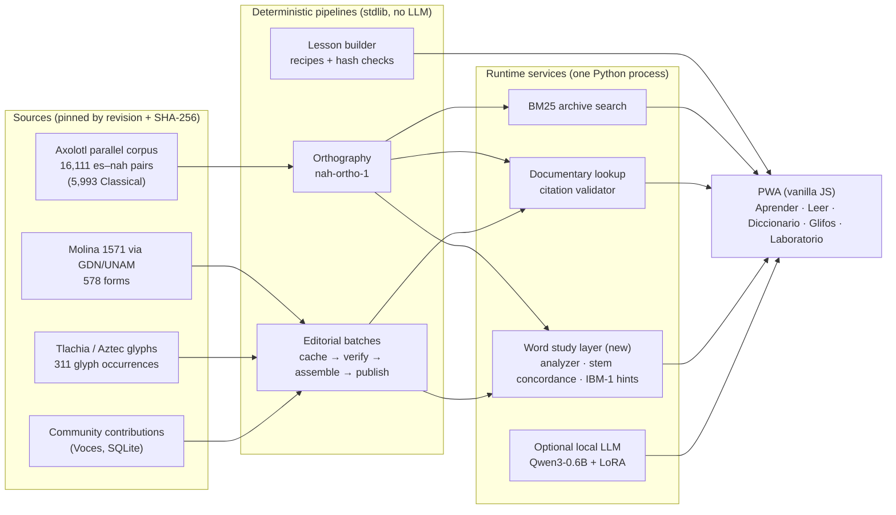

# Amoxcalli: architecture and design decisions

[Español: README](../README.md) · [Word analysis guide (ES)](MORFOLOGIA.md) · [Evaluation report (ES)](../reports/MORFOLOGIA_EVALUACION.md)

Amoxcalli is a local, offline-first application for **learning to read Classical Nahuatl from sourced examples**. You read a passage, work out a word, look at other passages that use it, and go back to the source. Every answer it shows points to evidence: a dictionary entry, an archive passage, or a glyph record with a URL and a hash. If it has no evidence, it says so.

This document explains the system for engineers. It covers what each layer does, why it is built that way, what has been measured and what is still weak.

## 1. System overview



| Layer | Main modules | Notes |
|---|---|---|
| Content | `corpus/*.json`, `corpus/axolotl/axolotl.csv`, `corpus/pictography/catalog.json` | Versioned bundles. Each record keeps original spelling, source, locator, verification status and rights (public / training). |
| Pipelines | `editorial_pipeline`, `editorial_release`, `lesson_builder`, `pictography_pipeline` | Scripts with no LLM. Batches are additive, backed up and hash-checked. Recipes are explicit, and a person makes the semantic decisions. |
| Retrieval | `retrieval` (BM25), `documentary_retrieval` | Every documentary hit carries field-level citations. `citation_valid` re-derives each citation from the source file and its hash. |
| Word study (new) | `morphology`, `stems`, `morphology_evaluation` | Morphological analysis, concordance by root, and gloss hints from the parallel corpus. See §3. |
| Model lab | `train`, `autotrain`, `benchmark`, `runtime` | LoRA experiments on Qwen3-0.6B. Results are shown honestly, including where they lose to retrieval. |
| App | `platform.py` (stdlib `http.server`), `platform_web/` | Runs on localhost by default. CSP is on, POST requests are origin-checked, and the app can be installed as a PWA. |

**Design principles**

1. **Evidence first.** The UI never shows a claim without the record it came from. Saying nothing (abstaining) is a valid answer.
2. **Deterministic before generative.** Wherever a script can do the job, a script does it: extraction, linking, lesson assembly, glossing. The LLM is optional and fenced off in the Laboratory.
3. **Every output says how it was produced.** Analyses carry a `basis` (`dictionary`, `particle_table`, `corpus`, `rules`), and hints carry their supporting passages.
4. **Reproducibility.** Inputs are pinned by hash. Derived artifacts store the fingerprint of their inputs and rebuild when that changes.
5. **Evaluation hygiene.** Splits are made by work (document), not by sentence. Gold sets have dev and test splits, and the protocol records any change made after looking at test.

## 2. The problem the new layer solves

Nahuatl is **polysynthetic**: one word often carries subject, object, possessor, direction, tense and the root together. Before this layer, every lookup in the app matched **whole words**: BM25 tokens, documentary search and the reading view's "Comparar aquí". As a result:

- *nocal* (my house), *calco* (in the house) and *calli* (house) never met.
- Colonial spelling splits the same word across many forms: *yhuan / ihuan / iuan*, *xihuitl / xiuitl*, *iquac / yquac / ihcuac*.
- The dictionary is a 578-form sample of Molina. Exact matching covered **0.8 %** of the distinct word forms in the Classical corpus.
- The lessons say it themselves: *NIQUITTA … el análisis de esta forma sigue pendiente* ("the analysis of this form is still pending").

## 3. Word study layer (`morphology.py`, `stems.py`)

### 3.1 Phonemic key with alignment back to the source spelling
`phonemic_key(word)` maps a word to an orthography-neutral phoneme string:

- *qu/c/k* → `k`
- *cu/qu + vowel, uc* → `kw`
- *hu/uh/u + vowel* → `w`
- *z/ç/c+e,i* → `s`
- *tz/ch/tl* each become one symbol
- the saltillo *h* and doubled vowels are removed
- the glide in *o(h)ua* is dropped

For each symbol it also keeps the **character span in the original word**. Segmentations are therefore always shown in the source's own spelling (`NI-QU-ITTA`), never in a normalized form.

### 3.2 Candidate generation (slot grammar)
- **Nominal prefixes:** possessor.
- **Verbal prefixes:** antecessive · subject · directional · object · reflexive.
- **Suffixes:** absolutive, possessed, plural, relational/locative, nominal derivation, verbal derivation and tense.

Allomorphy constraints prune the candidates:

- *-tl* after a vowel, *-tli* after a consonant, *-li* after *l*
- *qui-* before a consonant, *c/qu-* next to vowels
- *quim-/im-* only before *m, p*
- subject and reflexive must agree (*ni-no-*, *ti-mo/to-*)

### 3.3 Scoring: three signals plus parsimony

```
score = dictionary_evidence(stem, POS-compatible)      # 6 if the stem is a dictionary root (less for 3-phoneme stems, none for shorter ones)
      + 1.1 · log(1 + corpus_type_frequency(stem))     # learned by hard EM over 26k corpus types
      + 0.5 · log-odds(noun vs verb usage of the stem)  # also learned by EM, from unambiguous markers
      − Σ affix_cost(len(affix))                        # long affixes (mitz-, -tzin) are rarely accidental
```

- **Hard EM (Morfessor-style):** each word type first spreads one vote evenly over its candidate stems. On every later iteration it votes only for the stem of its current best analysis. The number of changed assignments goes 15,522 → 1,188 → 290, so it converges within three iterations.
- **POS agreement:** a verbal analysis cannot lean on a noun entry, and vice versa. This removes spurious matches such as *quim-aca* backed by Molina's "Aca: alguno".
- Each result also returns ranked alternatives and a softmax "relative preference" over them. The UI says plainly that this is a preference between candidates, not a calibrated probability.

### 3.4 Concordance by root
`StemConcordance` builds an inverted index from root to Classical passages. In the UI this becomes "the root *cal* appears in 579 passages, in 42 different forms", with examples you can click.

### 3.5 Gloss hints (IBM Model 1)
EM runs over the 5,453 aligned Classical pairs, with Nahuatl roots plus a NULL word as the source and Spanish content words as the target. Spanish words copied over untranslated (names, calendar signs) are excluded. Each hint keeps its translation probability, Dice score and supporting passage IDs. The UI shows a hint only when **≥ 3 passages** support it, and always marks it with "≈".

### 3.6 Product surface
- **Readings:** every word is clickable. The panel shows morpheme chips, the matching dictionary entry with a save button, hints, other passages with the same root, and alternative analyses. Editorial annotations keep priority, and cloze exercises are left untouched so answers aren't revealed.
- **Interlinear gloss** toggle (Leipzig-style lines): source word · segmentation · tags · gloss, with the source of each gloss marked.
- **Dictionary:** when a search finds nothing, the app suggests an analysis. For example, *nocalco* → *no-cal-co* → *calli · casa*.
- **API:** `GET /api/word?w=…&exclude=<passage>`, `GET /api/gloss?id=<axolotl-id>|text=…`. Each response contains `model_calls: 0`.
- **Cost:** about 0.2 ms per word once warm. The first start builds the derived files in about 45 s; later starts load them from `data/derived/` (which is gitignored) in about 7 s.

## 4. Results (`python3 -m nahuatl_local.morphology_evaluation`)

**Segmentation gold set:** 52 forms written by the team from textbook paradigms, split 25 dev / 27 test, and still awaiting specialist review.

| System | Exact segmentation top-1 | dev / test | In top-3 |
|---|---:|---:|---:|
| Unsegmented baseline | 0 % | 0 / 0 | 0 % |
| Rules only | 15 % | 8 / 22 | 62 % |
| Rules + dictionary | 44 % | 48 / 41 | 75 % |
| Rules + corpus EM | 73 % | 80 / 67 | 92 % |
| **Full** | **77 %** | **84 / 70** | **92 %** |

In the first test run the full system scored 63 % on test. After that run, two general bugs were fixed: POS agreement, and short nouns that are listed whole in the dictionary such as *atl*. The first-run report is kept in `reports/morphology-evaluation-first-test-run.json`. **Corpus statistics give the biggest gain.** With a 578-form dictionary, the unlabelled corpus does more than the lexicon.

**Coverage of the Classical corpus** (135,288 tokens):

| Measure | Value |
|---|---|
| Exact dictionary match | 20.3 % of tokens · 0.8 % of word types |
| Root linked to a dictionary entry or a particle | 41.8 % of tokens · 3.9 % of word types |
| At least one affix or link explained | 84.1 % of tokens |

**Concordance:** for 117 dictionary roots, searching by root finds 6,391 passages against 3,493 for exact-word search. I spot-checked 60 of the newly found hits myself: 56–57 are the same lexeme. The errors are homographs, for example *neua* "I" vs *tenehua* "to name". The sample is in `reports/morphology-review/stem-hits-sample.csv`, for linguistic review.

**Gloss hints compared with Molina's definitions** (101 entries; Molina was not used to build the hints):

| Method | Precision@1 | Hit@3 |
|---|---:|---:|
| Raw co-occurrence | 24 % | 40 % |
| Dice | 23 % | 36 % |
| IBM-1 | 30 % | 39 % |

These numbers are modest and expected. Molina's Spanish is from the 16th century and a 4–5 character match is a strict test. The point of the hints is a lead you can check against passages, not a definition.

## 5. The LLM: what the evidence says, and where it should sit

The lab fine-tuned **Qwen3-0.6B with LoRA** (r=8, q/v projections, 1.15M trainable parameters, about 650 pairs actually seen) for Spanish → Classical Nahuatl. On the same 20 held-out test sentences (chrF++):

| System | chrF++ |
|---|---:|
| Base model, no adapter | 15.4 |
| LoRA `classical-v2` | 16.0 |
| LoRA `classical-v2` + retrieved passages in the prompt | 22.4 |
| LoRA `continued-unseen` (the one the app uses) | 20.3 |
| LoRA `automatic` run (repetition collapse, 53 % repeated trigrams) | 9.5 |
| **Simply returning the top BM25 passage** | **27.2** |

These are 20 sentences with no linguistic review (`reports/benchmark-*.json`), so the confidence intervals are wide. The ranking is still unambiguous.

That table carries the main architectural conclusion: **with this much data, retrieval beats generation**, and a generator that can't be verified works against the project's goal. Changes I would make, in order:

1. **Reverse the role.** Learners read Nahuatl. The useful direction is nah → es *explanation*, not es → nah *composition*.
2. **Make the LLM a narrator over grounded tools, not an oracle.** Run it as a tool-calling agent with `analyze_word`, `concordance`, `dictionary` and `gloss_hints`. It must cite record IDs, and the existing `citation_valid` checks those citations and rejects any sentence without support. Abstaining stays allowed. The deterministic layer in §3 is exactly the toolset this needs.
3. **Morphology-aware input.** Segmenting with the analyzer before tokenizing is a known win for polysynthetic, low-resource MT. The tokenizer audit in `data/prepared/manifest.json` already shows the cost: 0.39 tokens per character for Nahuatl.
4. **Evaluate faithfulness, not just chrF.** Measure citation precision, abstention rate and human judgment on a reserved, reviewed set. Compare retrieval, base model and adapter on the same cases. That is item 6 in `docs/PROPOSITO.md`.

## 6. Known limits and open questions

- The affix and particle tables are compiled from reference grammars (Andrews 2003; Launey 1992). Reduplication, vowel length, irregular preterites and compounds of more than two roots are not modelled.
- IBM-1 hints inherit corpus biases. In the annals, *tlatoa* (to speak; *tlahtoani* ruler) co-occurs with "murió" (died) because rulers' deaths are recorded so often. That is why every hint shows how many passages support it and the "≈" marker.
- The analyzer conflates real homographs (*toa* in *tlatoa* vs *itoa*). The ranked alternatives make that visible instead of hiding it.
- **Orthography question for review:** `nah-ortho-1` maps `ç → tz`. GDN's own normalization maps Molina's `ç → z` (for example *çan → zan*, *çacatl → zacatl*), which matches the common reading of colonial `ç` as /s/. The analyzer uses `ç → s`. It might be worth checking which convention the project wants.
- Nothing here measures reading comprehension. That still needs learners and a facilitator (`docs/PILOTO_INSTITUCIONAL.md`).

## 7. Running it

```bash
bash scripts/plataforma.sh                         # app on http://127.0.0.1:8766 (stdlib only)
python3 -m nahuatl_local.morphology niquitta nocalco  # CLI analysis
python3 -m nahuatl_local.morphology_evaluation     # regenerate the report
python3 -m unittest tests.test_morphology          # 16 tests, ~2 s
```
