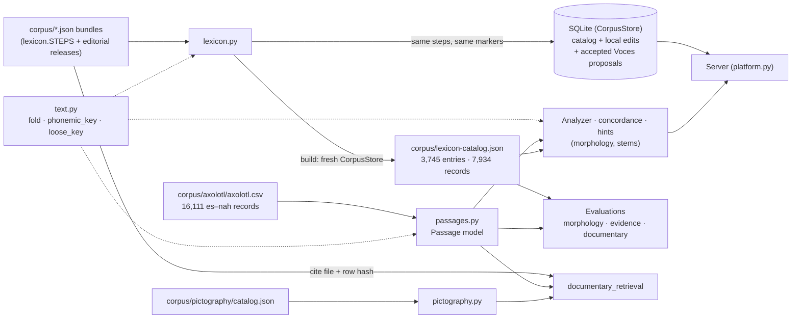

# Amoxcalli: data schema and data flow

[Español: README](../README.md) · [Word analysis (ES)](MORFOLOGIA.md) · [Ask with evidence (ES)](EVIDENCIA.md) · [Documentary evaluation (ES)](EVALUACION_DOCUMENTAL.md)

Amoxcalli is a local app for learning to read Classical Nahuatl from sourced examples. Every answer points to a record that can be cited by file and hash. This page describes the one data paradigm all code follows: **three versioned sources, one reader each, one normalization module, and the same records for the server, the analyzer and the evaluations.**

## 1. Sources and their single readers

| Source | Only reader | What everyone else gets |
|---|---|---|
| `corpus/axolotl/axolotl.csv` (no header; id = 1-based CSV record, `axolotl-00001`) | `passages.py` (`parse`/`records` for raw fields, `load` for passages) | The **passage model** below. Raw fields are kept only where they are cited or hashed (documentary citations, training-split preparation). |
| Lexical bundles `corpus/seed.json` … `flor-lexicon-v8.json`, plus releases in `corpus/editorial-releases.json` | `lexicon.py` (`STEPS`, `releases`, `steps`) | The **canonical catalog** `corpus/lexicon-catalog.json`, generated by `python -m nahuatl_local.lexicon` from a fresh `CorpusStore` and checked against the bundle hashes on every load. |
| `corpus/pictography/catalog.json` | `pictography.py` | Documents, pages, zones, elements, occurrences (unchanged by this paradigm). |

Bundles are never edited: they are the evidence cited by file and hash. Corrections enter as a new bundle (a new `Step` or an editorial release) or as a reviewed Voces proposal.

## 2. Schemas

**Passage** (`passages.passage`): `id`, `line`, `nah`, `es` (both verbatim), `variant`, `iso` (`unknown` if missing), `variant_label`, `period` (`historical` for `nci`, `modern`, `unknown`), `document` (the work), `locator`, `source_url`, `rights_note`, `verification`.

**Record** (unit stored, edited, cited and proposed): `kind` ∈ `sense` (Spanish definition, `pos`, `aliases`), `form` (`written` as in the source, `catalog_normalized`, `sense_id`, `period`, `variant`, `variation_kind`), `glyph` (`sense_id`, `reading`, `image`, `association`), `source`, `text`, `note`. Every record carries `rights` (`public` and `training`, declared separately), `verification` (`inherited` < `catalog_checked` < `reviewed`) and `evidence` (`source_id`, optional `via_source_id`, `locator`, `status`).

**Lexical entry** (`lexicon.entries`): forms whose phonemic key matches (*quauitl*/*cuahuitl*, *iuan*/*ihuan*) and the senses they belong to form one entry: `id`, `lemma`, `key`, `loose_key`, `senses`, `forms`, `glyphs` (complete records, unmodified), `spellings`, `sources`, `rights` (`training` only if every sense and form allows it), `review` (lowest status, automatic transcription, primary check).

**Public closure** (`lexicon.public_closure`): a record is public only if it and everything it depends on (sense, sources, association targets) is public. One implementation, used by the store, the catalog and the documentary evaluation.

## 3. Who reads what

| Consumer | Lexical records | Passages |
|---|---|---|
| Server (`platform.py`, `CorpusStore.public_records()`) | Catalog + this installation's local edits and accepted proposals | `research.Archive` → `passages.load` |
| Analyzer, concordance, gloss hints, term index, Ask (`stems`, `terms`, `evidence`) | Server: the store; offline/CLI: `lexicon.load_records()` | `passages.load` |
| `morphology_evaluation`, `evidence_evaluation`, `documentary_retrieval_evaluation` | `lexicon.load_records()` (no private database is opened) | `passages.load` |
| `documentary_evaluation` / `documentary_retrieval` citations | `lexicon.source_rows`: the bundle row and file that a citation hashes | Raw CSV fields via `passages.original` |

`tests/test_lexicon.py` asserts that a fresh store publishes exactly the catalog, so "what the server serves" and "what the evaluations measure" differ only by local data. `python -m nahuatl_local.lexicon --migrate DB` backs a local database up (`data/backups/voces-before-lexicon-catalog-v1.sqlite3`), applies pending steps (additive: an update never replaces a local edit), records the catalog it sits on and checks that every previous row survives; it reports edited, local-only and hidden IDs.

## 4. Normalization (`text.py`)

| Function | Neutralizes | Used for |
|---|---|---|
| `fold` | case and diacritics | Spanish search, catalog labels; the browser's single `norm` in `platform_web/app.js` is its twin |
| `phonemic_key` | colonial spelling (qu/c/k, hu/uh/u, z/ç/c, saltillo h, y/i, long vowels) with spans back to the source spelling | the analyzer; **frozen**: its output over the 76,698 archive word types is fingerprinted in `tests/test_text.py` |
| `loose_key` | additionally modern spelling (k, kw, ts, w, j) and double consonants | retrieval only: the term index (§7) and through it every search view |

Helpers: `strip_marks`, `squash`, `tokens`, `es_key`, `key_of`, `readable`. `tests/test_text.py` fails if any other module strips diacritics, defines another key or parses a CSV itself.

**`nah-ortho-1` (`nahuatl_orthography.py`) stays frozen and separate.** It is not a lookup key: `storage` cleans text that is persisted and `comparison` is the dedup key of the training splits and the archive BM25. Its version and rule IDs are recorded in `data/prepared/manifest.json` and benchmark reports, so changing it would invalidate published splits and scores. It now reuses `text.strip_marks`. Open question for review: it maps `ç → tz`, while GDN and the analyzer read colonial `ç` as /s/ (`ç → s`); a revised convention should ship as `nah-ortho-2` with re-measured benchmarks, not as an edit.

## 5. Changing data safely

1. New lexical data → a new bundle or editorial release → `python -m nahuatl_local.lexicon` → `python -m nahuatl_local.lexicon --migrate data/community/voces.sqlite3`.
2. Re-measure what reads it: `python -m nahuatl_local.morphology_evaluation`, `python -m nahuatl_local.evidence_evaluation`, `python -m nahuatl_local.documentary_retrieval_evaluation` (backs up its previous report), then `python -m nahuatl_local.documentary_laboratory`. A change to `documentary_evaluation.py` also requires `python -m nahuatl_local.documentary_evaluation` (rebuilds and validates the battery by reconstruction).
3. Any change to `text.py` that alters `phonemic_key` must update the fingerprint in `tests/test_text.py` *after* re-measuring the analyzer.

Measured results live in `reports/` (`MORFOLOGIA_EVALUACION.md`, `EVIDENCIA_EVALUACION.md`, `documentary-retrieval-v1.json`); the before/after comparison of this paradigm change is in `reports/data-paradigm-comparison-2026-10-15.md`.

## 6. Serving

One process serves the app, Voces (`/aportar`) and the API: `bash scripts/amoxcalli.sh serve` (`setup` also installs the local model). `web.py` owns what every route shares — the route table, JSON errors (400/401/403/404/405/500, tracebacks to stderr without query or body), security headers and CSP, allowed hosts, the `Origin` check on writes, static files, and a listen queue of 64. `platform.py` registers the application routes and `community.py` the Voces routes; neither has its own server.

## 7. Term index and the single search (`terms.py`)

A **term group** gathers everything known about one word: the lexical entry (`lexicon.entries`) or, when the dictionary lacks it, an archive spelling (`term-…`: *cualli*, *cihuatl*); its senses; every attested spelling with the same loose key (colonial and SEP/INALI, counted by variety); inflected forms of the same root that the analyzer backs with that dictionary entry; passages by variety; and pictographic references with their scope — dictionary glyphs (`terms.glyph_scope`: whole word, component, meaning relation, thematic) and Tlachia elements (designation or explicit lexical link → component) and occurrences (reading contains the word → whole word; element among its components → component). No image is generated.

Uncertain spellings are kept apart with their reason and never counted as the term: same written root in a verb or a *tla-/te-* derivative (*tlacualli* for *cualli*, *quicohua* for *coatl*), a root with no dictionary entry, a bare or very short root, a spelling owned by another entry, or a word that merely contains the term (*mixcoatl*, *cihuapilli*).

`TermIndex.search` is the only search: normalize (`parse`: question → word, `fold`) → loose key, then analyzer root → order (`terms.SCORES`; the detected language first). Dictionary (`/api/terms`), Archive (`/api/research`: a resolved word returns the passages of all its certain spellings, otherwise BM25 for phrases), Ask (`/api/ask`, `terms` field) and Documentary lookup (`/api/documentary`: the group's cited records first, then the measured ranking, unchanged) all call it; the browser draws the same block (`platform_web/terms.js`). Measured by `python -m nahuatl_local.term_evaluation` (`evaluation/term-groups-v1.json`, `reports/TERMINOS_EVALUACION.md`).
