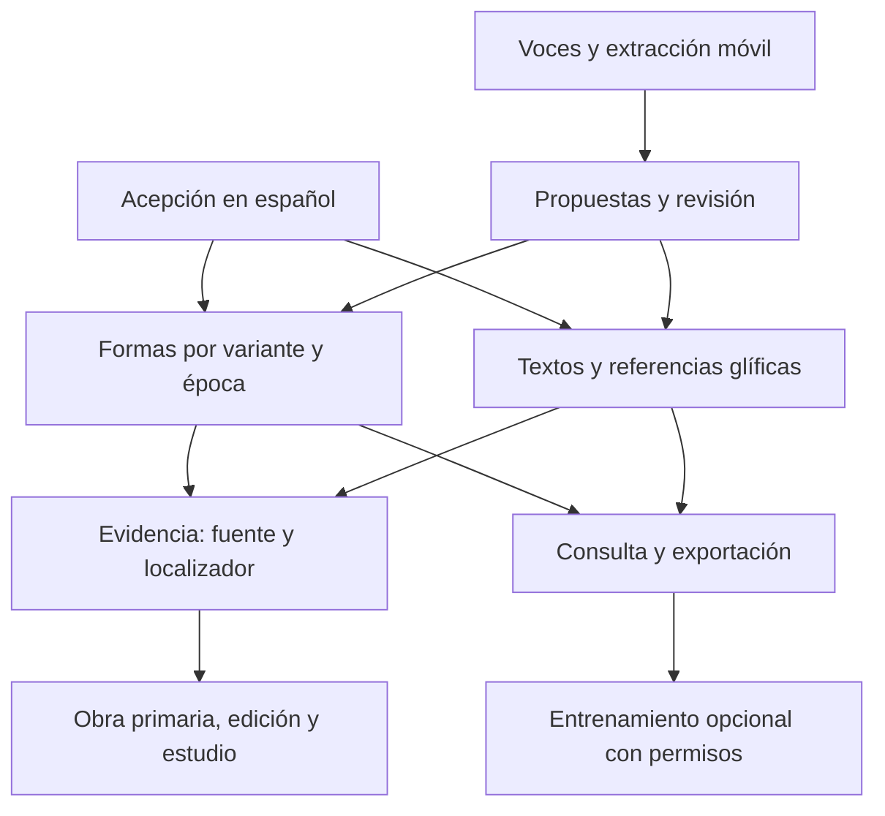

# Operar una instalación de Amoxcalli

Modelo de datos, arranque, revisión, importación y exportación. Qué ofrece la aplicación: [README](../README.md); teléfono y HTTPS: [WEBAPP.md](WEBAPP.md); diseño: [ARCHITECTURE.md](ARCHITECTURE.md). Python y SQLite; no necesita APIs, PyTorch ni un LLM para consultar o aportar.

## Una plataforma, un corpus

Voces deja de ser una app desconectada. La entrada principal de Amoxcalli reúne Aprender, Leer, Diccionario, Mis palabras y Laboratorio. Archivo completo, fichas textuales y fuentes están en «Archivo y herramientas». La escritura, grabación y revisión comunitaria de Voces viven en `/aportar`. Comparten servidor, cookies de sesión y `data/community/voces.sqlite3`.

La unidad léxica es una **acepción**, no una traducción universal. «Árbol» y «madera» tienen IDs distintos; «luna» y «mes» también. Cada acepción puede tener numerosas formas por variante, localidad, época y convención de escritura. `quauitl` y `cuahuitl` muestran una relación ortográfica heredada; no se hacen pasar por dos dialectos modernos.



## Arranque y actualización

```bash
bash scripts/plataforma.sh
```

Abre http://127.0.0.1:8766 (`make demo` prepara antes los análisis derivados). Para otra ubicación de la base:

```bash
python3 -m nahuatl_local.platform --db /ruta/mi-corpus.sqlite3 serve
```

Antes de actualizar una instalación con datos, detén el servidor y copia `data/community/` a un respaldo privado. Conserva tu carpeta `data`; no está en el repositorio. La migración crea únicamente tablas `corpus_*`, no sobrescribe las tablas de Voces ni modifica pesos. La semilla se importa una vez; los registros tienen ID y versión. Los datos de pruebas están en directorios temporales y no se distribuyen.

Se recuperó la fuente de Amoxcalli en el commit `3e8a7a67f995f92858519c6cffe15e74d0e7c794`. Se portaron sus 17 registros y sus reglas limitadas de composición. `corpus/scriptorium-legacy.json` conserva la procedencia; `corpus/seed.json` es el corpus normalizado. No se trasladó la dependencia del cliente OpenAI. El alojamiento anterior permanece en su versión previa; este paquete es la versión local integrada.

## Catálogo instalado (semilla y migraciones)

| Entidad | Cantidad | Estado |
|---|---:|---|
| Acepciones / entradas | 575 | 26 curadas + 549 transcripciones automáticas de Molina/GDN; traducción histórica intacta |
| Formas | 578 | Paleografía de fuente; grafía normalizada del catálogo en campo separado |
| Textos | 3 | Dos fragmentos heredados y una referencia sin transcripción |
| Referencias glíficas | 140 | 139 entradas con imagen; 24 imágenes distintas, contexto, folio y atribución |
| Fuentes | 20 | Primarias, ediciones, investigación, catálogos y testimonio comunitario |
| Nota gramatical | 1 | Regla limitada; no certifica oraciones nuevas |

«Aún no hay glifos vinculados a esta acepción» señala una tarea pendiente de catalogación local. No afirma que el glifo no exista. Cada ficha ofrece acceso al Visual Lexicon of Aztec Hieroglyphs. Los glifos vinculados distinguen la referencia al catálogo del cotejo primario y de la interpretación de la acepción. La misma forma puede pertenecer a distintas acepciones. Un elemento glífico dentro de un topónimo no equivale automáticamente a una palabra aislada ni a todas sus realizaciones contemporáneas.

UNAM, INALI e INAH tienen prioridad de navegación, junto con recursos complementarios de Oregon y Getty. Las nuevas fichas consultadas incluyen Tlachia, el diccionario de Thouvenot basado en Molina, el artículo de Silva Galeana y Silva Cruz (2021) y la guía de Thouvenot (2023). No se copian libros completos ni se infiere que «acceso abierto» autorice cualquier uso de entrenamiento.

La colección inicial **todavía no es un corpus exhaustivo ni una traducción fiable**. Hay formas sin cotejo primario y grandes vacíos dialectales. La estructura permite llenarlos mediante importaciones y revisión documentada.

## Proponer desde computadora o teléfono

1. Abre Voces, elige tu variante o autodenominación y crea un seudónimo. Se conserva el perfil existente si ya lo tenías.
2. Desde una acepción, pulsa «Aportar una forma o evidencia», o entra en Aportar.
3. Elige forma léxica, fragmento o glifo. Conserva la escritura del documento y añade fuente y página/folio/entrada. En testimonios propios, identifica una sesión; evita datos personales.
4. Declara por separado revisión, consulta y entrenamiento. En la época contemporánea se conserva una copia de la variante del perfil. La clasificación histórica sigue siendo una propuesta por revisar.
5. Envía. La propuesta no aparece en el corpus público hasta ser aceptada y tener permiso de consulta. Puede retirarse desde «Mis aportaciones al corpus».

La voz sigue en Voces: grabación, carga, escucha y revisión por variante, con los permisos originales. Las respuestas antiguas de Voces **no se hacen públicas automáticamente**: su consentimiento original solo cubre el proyecto. Los datos de voz no se promocionan al catálogo público por una mera votación. Sus exportaciones revisadas siguen disponibles mediante la CLI de comunidad.

El extractor actual permite transcripción **manual**; no realiza OCR, segmentación automática de facsímiles ni reconocimiento de voz. Se pueden añadir después como generadores de propuestas, conservando el documento de origen, el localizador y la corrección humana.

Acceso desde el teléfono, HTTPS y micrófono: [WEBAPP.md](WEBAPP.md).

## Revisión: responsabilidad del organizador

La revisión que modifica el corpus se realiza desde terminal; no hay un botón de administrador accesible a cualquier visitante.

```bash
python3 -m nahuatl_local.platform queue
python3 -m nahuatl_local.platform review ID_DE_PROPUESTA \
  --decision accepted --reviewer 'Nombre o ID del revisor' \
  --reason 'Explicación del cotejo y de los permisos' --rights-checked
```

`--rights-checked` es una declaración del revisor: hay que revisar la fuente y los permisos, no solo marcarla. Para afirmar cotejo con una fuente primaria, añade `--primary-checked`, con una fuente registrada como primaria y una justificación concreta. En glifos, esto cambia el estado de «propuesto» a «documentado en este contexto». El programa valida la estructura de la declaración; **no puede comprobar que el revisor haya leído el original**.

Para rechazar usa `--decision rejected` y explica por qué. Las propuestas no se modifican silenciosamente: el autor puede retirar y enviar una corrección. Los desacuerdos y grafías alternativas se conservan en aportaciones separadas.

El retiro elimina el contenido del registro activo y su historial de contenido, conserva una marca de retiro y lo excluye de nuevas consultas y exportaciones. Si otros registros dependían de uno privado o retirado, dejan de mostrarse también. Los archivos ya exportados o los modelos ya entrenados no pueden deshacerse por ese mecanismo.

## Incorporar fuentes, estudios y nuevos conceptos

Ejemplo real adicional, incluido como plantilla, de un proyecto de investigación de la UNAM:

```bash
python3 -m nahuatl_local.platform import templates/corpus-import.json \
  --reviewer 'Tu nombre' --reason 'Registro bibliográfico del proyecto y revisión de su ficha'
```

El JSON raíz contiene `schema_version: 1` y `records`. Se admiten `source`, `sense`, `form`, `text`, `glyph`, `note`. Usa IDs estables y distintos. Una segunda importación que edita un ID necesita `expected_version` igual a su versión actual; el lote completo se rechaza si hay referencias rotas o conflictos. No se elimina el corpus anterior al importar.

| Entidad | Campos que dan sentido al registro |
|---|---|
| Fuente | Autor, título, fecha, institución, idioma, tipo, URL, derechos; `primary_source_id` si es una edición vinculada |
| Acepción | Lema español, definición, categoría, alias; separar polisemia |
| Forma | `sense_id`, `written`, época, variante, ortografía y relación de variación |
| Texto | Náhuatl, español si está disponible, transcripción o referencia sin texto, variante, época, acepciones relacionadas |
| Glifo | Acepción, lectura, contexto del compuesto, fuente primaria, folio y estado de propuesta/cotejo |
| Nota | Explicación o estudio con evidencias enlazadas |
| Evidencia | `source_id`, `locator`, estado y, si corresponde, `via_source_id`; quién y cuándo cotejó el original |

Todos los registros necesitan derechos de consulta y entrenamiento separados y estado de verificación. Las formas no se normalizan al guardar; solo se usa normalización auxiliar para buscar sin acentos. La comparación lingüística nunca se deduce de esa normalización.

Usa `corpus/seed.json` como ejemplo completo del contrato. El validador operativo está en `nahuatl_local/corpus.py`. Se mantienen versiones y motivos de cambios en SQLite. Es un esquema v1 extensible; faltan coordenadas de facsímil/IIIF, morfología detallada, relaciones etimológicas y revisión editorial múltiple.

## Exportar para investigación o para modelos

En la interfaz se exportan el corpus consultable, una ficha con fuentes y citas bibliográficas. Es una copia para investigación local: los derechos de cada registro siguen aplicando.

```bash
python3 -m nahuatl_local.platform export --purpose research --output corpus-investigacion.json
python3 -m nahuatl_local.platform export --purpose training --period modern --output entrenamiento-moderno.json
python3 -m nahuatl_local.platform export --purpose training --period historical --output entrenamiento-historico.json
```

No se sobrescribe un archivo existente. El exportador de entrenamiento exige: revisión registrada, permiso del registro y de sus fuentes, variante conocida, transcripción/forma válida y, en lo histórico, cotejo primario declarado. Excluye glifos y simples referencias sin texto como pares de traducción. La semilla inicial produce **cero pares habilitados para entrenar**; esto evita heredar permisos no demostrados de catálogos. Las aportaciones propias revisadas pueden habilitarse con sus consentimientos.

Los registros exportados conservan grupo de fuente y, para aportaciones nuevas, grupo seudónimo de hablante. `split` queda en `unassigned`: antes de entrenar se debe separar por obra/hablante, deduplicar, evaluar alineación y evitar contaminación entre conjuntos. No se escriben automáticamente los archivos de entrenamiento. Un entrenador futuro debe respetar estos campos y mantener corpus clásico y variantes contemporáneas separados.

## Modelo y revisión humana dentro del ecosistema

El modelo se activa cuando sus dependencias, base y adaptador están disponibles; `scripts/iniciar.sh` los prepara. La búsqueda principal consulta el archivo completo, no sólo el léxico editorial. Resultados reales: [MODEL_CARD.md](../MODEL_CARD.md).

El laboratorio porta las reglas limitadas de Amoxcalli: palabra aislada, «veo + un objeto singular» y coordinación de dos sustantivos. Toda oración nueva se marca como propuesta. No cubre negación, otros tiempos o número por inferencia.

Para habilitar el modelo existente, instala y descarga primero sus dependencias como indica el README y arranca:

```bash
bash scripts/plataforma.sh --enable-model --adapter outputs/continued-unseen/run/best
```

La carga es perezosa y local. Se conserva el modelo, entrenamiento y evaluación previos; no se volvió a entrenar durante esta integración. Los splits de entrenamiento y sus comandos se conservan. El CSV íntegro de Axolotl ahora se consulta como archivo separado, con etiquetas y atribuciones de origen. Sus pasajes no se convierten automáticamente en fichas editoriales aprobadas ni en nuevos pares autorizados de entrenamiento.

La ficha de revisión exporta candidato, entrada y evidencias para evaluación humana. Las reglas locales no certifican fidelidad lingüística y no se conectan a servicios de evaluación.

## Archivo de consulta

`research.py` consulta el CSV íntegro de Axolotl conservando 16,111 pares y sus etiquetas. `/api/research` pagina y filtra; `/api/research/<id>` conserva una referencia estable dentro de la revisión fijada. La fuente editorial `src-axolotl` se añade con una migración que no sobrescribe modificaciones existentes. Este archivo no altera los splits del entrenamiento ni la publicación de aportaciones pendientes.

Las consultas con texto se ordenan con BM25 en español y náhuatl; los filtros y la paginación se aplican sobre los resultados. El campo náhuatl usa las reglas seguras de comparación de `nah-ortho-1`; el español conserva su tokenización. Los resultados muestran el texto original. La navegación sin consulta conserva el orden del archivo. La recuperación de contexto del laboratorio usa el mismo índice, limitada a náhuatl clásico y pasajes breves. Este índice completo no participa en el benchmark reservado, que utiliza solo `train.jsonl`.

La política CSP de Amoxcalli permite imágenes de `https://aztecglyphs.wired-humanities.org` para los cuatro enlaces aprobados. El servidor de Voces por separado mantiene imágenes locales. Scripts, conexiones y otros orígenes de imágenes conservan sus restricciones. Se comprobó la carga real de agua, casa, flor y árbol florido en el navegador, además del encabezado HTTP.

Las propuestas de clasificación del archivo están en `corpus/variant-proposals-v1.json`, pendientes de decisión; la ampliación de las acepciones y el trabajo necesario para una plataforma editorial compartida se describe en [LEXICO_GOBERNANZA.md](LEXICO_GOBERNANZA.md).

## Más guías

[Laboratorio](LABORATORIO.md) · [Lecturas por recetas](LECTURAS_PIPELINE.md) · [Pipeline editorial](EDITORIAL_PIPELINE.md) · [Léxico y glifos](LEXICO_GOBERNANZA.md) · [Diccionario pictográfico](DICCIONARIO_PICTOGRAFICO.md) · [Voces](VOCES.md)
