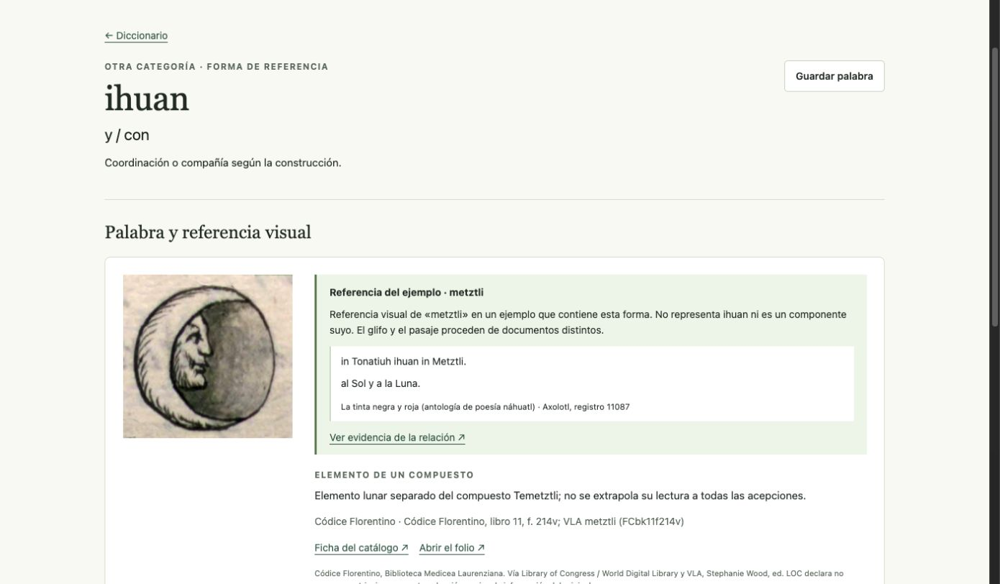

# Referencias glíficas y orden del diccionario · 30 de septiembre de 2026

Implementado un script local determinista, sin LLM, OCR, embeddings ni solicitudes de red. Comando:

```bash
.venv/bin/python -m nahuatl_local.glyph_linker
```

La reproducción en `/tmp` produjo el mismo JSON byte por byte, SHA256 `a8a377fa70fdb2a2ae6af2b27d555830bf9dad0b746e021579fd1116bf285fe3`, en 0,338 s. El script usa SQLite temporal para validar; no abre la base privada. La migración instalada añadió 79 entidades. Las 1.094 entidades anteriores, versiones/fechas y tablas privadas se conservaron exactamente. Respaldo previo privado con permisos 0600; [informe de conservación](data-preservation-v7.json).

- 523 entradas y 526 formas preservadas.
- 24 palabras representativas en página 1, en el orden solicitado; todas con una referencia visual guardada.
- Otras 499 en orden alfabético por forma náhuatl, 48 por página; comprobadas todas sin omisiones/duplicados.
- 99 entradas con imagen; 424 pendientes de evidencia, enumeradas en [glyph-coverage-v7.json](glyph-coverage-v7.json). La cobertura total todavía no está conseguida.
- 100 referencias glíficas en el catálogo, 23 imágenes distintas, 20 fuentes, 1.173 entidades.
- 78 vínculos nuevos: 2 de significado, 39 a referentes de la definición y 37 a referentes de un ejemplo clásico. Estos dos últimos son ayudas contextuales, no componentes morfológicos ni lecturas de la palabra.

Los ejemplos requieren tokens exactos de la forma paleográfica, del referente náhuatl y del término español, con variedad `nci`. No se sustituye la paleografía por la grafía normalizada de GDN. Cada enlace conserva fuente, localizador y crédito; las dependencias se registran y se oculta una relación si se retira su referencia. Todas las asociaciones nuevas excluyen entrenamiento. Las imágenes enlazan directamente a la ficha de origen y conservan una alternativa si falla su carga.

Validación: [153 pruebas Python](tests-glifos-2026-09-30.txt), todas pasan con 1 fallo esperado; [6 bloques DOM/HTTP](platform-ui-glifos-2026-09-30.txt), todos pasan. Se verificó en navegador la portada, la distinción explícita del ejemplo de ihuan y la carga de las nuevas imágenes de Tlachia y Tlecuauh. La navegación a una palabra lleva al inicio de su ficha. El LLM y sus pesos permanecen sin nuevos entrenamientos.


